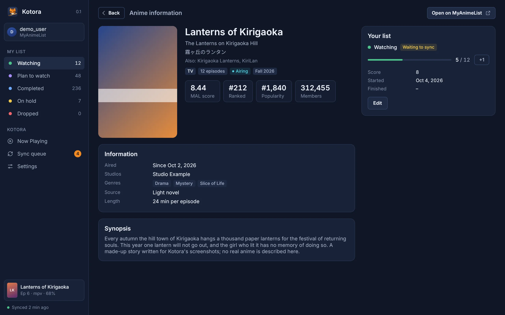

# Kotora 小虎

A native anime tracker for Linux and macOS, written in Rust.

Kotora ("little tiger") keeps your [MyAnimeList](https://myanimelist.net) list up to date. It sees which
episode is playing in your media player, and asks before it records it. Your list stays on MyAnimeList;
Kotora is only a client for your own account.

Website: <https://kotora.moe> · Support: <https://ko-fi.com/hanami117>


| Now Playing | Search and add | Details |
|---|---|---|
|  |  |  |

*The screenshots show made-up data.*

**Status:** version 0.1.0 is not released yet. Linux is the main target; macOS builds from source.

## Features

- Your MyAnimeList list: Watching, Plan to watch, Completed, On hold, Dropped, with covers, progress,
  score and airing information.
- Recognises the episode in your player and offers to record it ("Update to episode 6"). Updating
  automatically is a switch, and it is off by default.
- Edit progress, score and status. Changes go to a visible sync queue, so they work offline and conflicts
  are shown, not hidden.
- Search your list and MyAnimeList, add an anime in one click, open a details page.
- Fast and small: no browser engine, a single binary, nothing running in the background that you didn't start.
- A command line, `kot`, to control the running app.

## Supported players

| Linux | macOS |
|---|---|
| mpv, VLC, mpc-qt, and other MPRIS players (Celluloid, Haruna, SMPlayer, …) | mpv, IINA, VLC |

Kotora finds a player by the video file it has open, with no setup. For an exact position and pause, mpv
needs an IPC socket: Kotora offers to add one line to your `mpv.conf` (only when you click). Kotora does not
play, download or fetch video. For streaming sites, use [MAL-Sync](https://malsync.moe).

## Install

### Arch Linux

AUR package `kotora`: coming soon.

### From source (Linux)

You need `rust`, `git` and `pkgconf`, and a Vulkan driver (`vulkan-radeon`, `vulkan-intel` or `nvidia-utils`).

```sh
git clone https://github.com/hanami117/kotora
cd kotora
./install.sh
```

This builds a release binary and installs `kotora` and `kot` into `~/.local/bin`, with the menu entry and
icons. Run `./install.sh` again after `git pull` to update. `./install.sh --uninstall` removes the program and
keeps your list, sign-in and settings. `PREFIX=/usr/local ./install.sh` installs elsewhere.

### macOS

Build with `cargo build --release -p kotora -p kotora-ctl`. A DMG comes later.

## First start: your MyAnimeList Client ID

MyAnimeList asks every app to have its own Client ID. It is free and takes a minute. Kotora's Welcome page
walks you through it:

1. Open <https://myanimelist.net/apiconfig> and press **Create ID**.
2. App type **other**, non-commercial use. Put `http://127.0.0.1:47321/callback` as the redirect URL
   (the Welcome page has a Copy button). The other fields can say anything.
3. Paste the **Client ID** (not the secret) into Kotora and press Save, then **Sign in**.

You can also run `kot config client-id ID`.

## Privacy

- Your list lives on MyAnimeList. Kotora keeps a local copy to work offline, and covers in a cache you can delete.
- Kotora talks only to MyAnimeList. No account of ours, no analytics, no telemetry.
- The sign-in token is stored in a file only you can read (`~/.local/share/kotora/tokens.json`), never in
  the database or logs. Kotora needs no client secret.
- Files: settings in `~/.config/kotora`, list and token in `~/.local/share/kotora`, covers in `~/.cache/kotora`.

## The `kot` command

`kot` talks to the running app.

```text
kot                    what Kotora is doing
kot list [STATUS|all]  your list (watching, plan, completed, on-hold, dropped)
kot +1 TITLE           one more episode
kot set TITLE EP [--status S] [--score N|none]
kot add QUERY|ID [--status S]
kot now                what plays, and the episode Kotora offers
kot confirm            record the offered episode
kot dismiss            not now
kot queue              changes waiting to sync
kot sync               send the queue now
kot config client-id ID
kot show | kot quit
```

## Credits and notices

Kotora is a tribute to [Taiga](https://taiga.moe/) by erengy, the anime tracker for Windows. Kotora shares no
code with Taiga.

Kotora is not affiliated with or endorsed by MyAnimeList or AniList. Third-party licences are in
[THIRD_PARTY_NOTICES.md](THIRD_PARTY_NOTICES.md).

## License

GPL-3.0-or-later. See [LICENSE](LICENSE).
