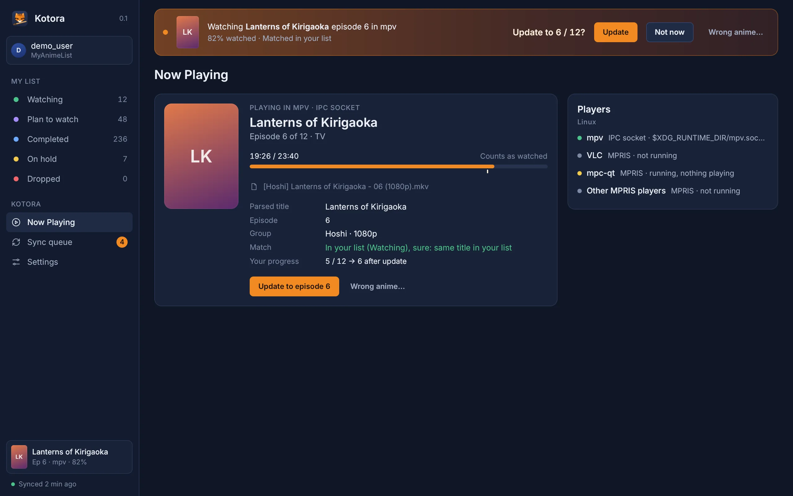

<p align="center"></p>

# Kotora 小虎

A native anime tracker for Linux and macOS, written in Rust.

Kotora ("little tiger") keeps your [MyAnimeList](https://myanimelist.net) list up to date. It sees which
episode is playing in your media player, and asks before it records it. Your list stays on MyAnimeList;
Kotora is only a client for your own account.

Website: <https://kotora.moe> · Support: <https://ko-fi.com/hanami117>


| Now Playing | Search and add | Details |
|---|---|---|
|  |  |  |

*The screenshots show made-up data.*

**Status:** version 0.1.2. MyAnimeList only; AniList comes later.

## Features

- Your MyAnimeList list: Watching, Plan to watch, Completed, On hold, Dropped, with covers, progress,
  score and airing information.
- Recognises the episode in your player and offers to record it ("Update to episode 6"). Updating
  automatically is a switch, and it is off by default.
- Edit progress, score and status. Changes go to a visible sync queue, so they work offline and conflicts
  are shown, not hidden.
- Search your list and MyAnimeList, add an anime in one click, open a details page.
- Fast and small: no browser engine, a single binary, nothing running in the background that you didn't start.
- A command line, `kot`, to control the running app.

## Supported players

| Linux | macOS |
|---|---|
| mpv, VLC, mpc-qt, and other MPRIS players (Celluloid, Haruna, SMPlayer, …) | mpv, IINA, VLC |

Kotora finds a player by the video file it has open, with no setup. For an exact position and pause, mpv
needs an IPC socket: Kotora offers to add one line to your `mpv.conf` (only when you click). Kotora does not
play, download or fetch video. For streaming sites, use [MAL-Sync](https://malsync.moe).

## Install

### Arch Linux

From the AUR, with your AUR helper:

```sh
yay -S kotora      # builds from the release's source
yay -S kotora-bin  # prebuilt x86_64 binary, no Rust toolchain needed
```

Both install `kotora`, `kot`, the menu entry and the icons, and they conflict with each other: pick one.
Updates come with your AUR helper. AUR pages: [kotora](https://aur.archlinux.org/packages/kotora) and
[kotora-bin](https://aur.archlinux.org/packages/kotora-bin).

The release page also has a Linux x86_64 tarball (`kotora-0.1.2-linux-x86_64.tar.gz`). It is built on Arch
Linux, so it needs a recent glibc; on other distros, building from source is the safer way.

### macOS

Apple silicon, macOS 13 or later. Download `Kotora-0.1.2.dmg` from the
[release page](https://github.com/hanami117/kotora/releases/latest) and drag Kotora to Applications.

Kotora is not notarized, so macOS refuses it at the first start: open **System Settings → Privacy & Security**
and click **Open Anyway** (or run `xattr -dr com.apple.quarantine /Applications/Kotora.app`). To use `kot`,
link it into your `PATH`:

```sh
ln -s /Applications/Kotora.app/Contents/MacOS/kot /opt/homebrew/bin/kot
```

### From source (Linux)

You need `rust`, `git` and `pkgconf`, and a Vulkan driver (`vulkan-radeon`, `vulkan-intel` or `nvidia-utils`).
On Debian or Ubuntu also `libdbus-1-dev`, `libxkbcommon-dev` and `libwayland-dev`.

```sh
git clone https://github.com/hanami117/kotora
cd kotora
./install.sh
```

This builds a release binary and installs `kotora` and `kot` into `~/.local/bin`, with the menu entry and
icons. Run `./install.sh` again after `git pull` to update. `./install.sh --uninstall` removes the program and
keeps your list, sign-in and settings. `PREFIX=/usr/local ./install.sh` installs elsewhere. The release's source
tarball (`kotora-0.1.2.tar.gz`) works the same way.

### From source (macOS)

With Rust and `librsvg` (`brew install librsvg`): `packaging/macos/build.sh` builds `target/macos/Kotora.app`.

## First start: your MyAnimeList Client ID

MyAnimeList asks every app to have its own Client ID. It is free and takes a minute. Kotora's Welcome page
walks you through it:

1. Open <https://myanimelist.net/apiconfig> and press **Create ID**.
2. App type **other**, non-commercial use. Put `http://127.0.0.1:47321/callback` as the redirect URL
   (the Welcome page has a Copy button). The other fields can say anything.
3. Paste the **Client ID** (not the secret) into Kotora and press Save, then **Sign in**.

You can also run `kot config client-id ID`.

## Privacy

- **No telemetry, no analytics, no account of ours.** Apart from your list service, the update check below is
  the only thing Kotora sends anywhere on its own.
- Your list lives on MyAnimeList. Kotora keeps a local copy to work offline, and covers in a cache you can delete.
- **Update check:** once a day, a plain GET of `https://updates.kotora.moe/latest.json` with the User-Agent
  `Kotora/<version>` and four values: the Kotora version, the OS (Linux or macOS), the processor type
  (x86_64 or arm64) and how it was installed (AUR, install.sh, Homebrew, DMG, …), plus a flag on the first
  check of a week and of a month. No id, no account, no list, file or anime names. The server adds one to a
  counter for that day and that combination; those daily counts are all it keeps: no IP address, no install
  or device id, no cookies. If that server can't be reached, Kotora asks `https://kotora.moe/latest.json`
  instead, which counts nothing. Kotora never downloads an update by itself: it shows a banner, and you
  choose. Turn it off in Settings → About Kotora → **Check for updates**; then nothing is sent.
- The sign-in token is stored in a file only you can read (`~/.local/share/kotora/tokens.json`), never in
  the database or logs. Kotora needs no client secret.
- Files: settings in `~/.config/kotora`, list and token in `~/.local/share/kotora`, covers in `~/.cache/kotora`,
  the update check's last answer and skipped version in `~/.local/state/kotora/update.json`.

## The `kot` command

`kot` talks to the running app.

```text
kot                    a dashboard: what plays, your Watching list with what comes next, the sync queue
kot status [--short]   what Kotora is doing (--short: one line)
kot list [STATUS|all]  your list (watching, plan, completed, on-hold, dropped)
kot +1 TITLE           one more episode
kot set TITLE EP [--status S] [--score N|none]
kot add QUERY|ID [--status S]
kot airing | schedule   your anime airing in the next 7 days
kot now                what plays, and the episode Kotora offers
kot confirm            record the offered episode
kot dismiss            not now
kot queue              changes waiting to sync
kot sync               send the queue now
kot config client-id ID
kot show | kot quit
```

## Credits and notices

Kotora is a tribute to [Taiga](https://taiga.moe/) by erengy, the anime tracker for Windows. Kotora shares no
code with Taiga.

Kotora is not affiliated with or endorsed by MyAnimeList or AniList. Third-party licences are in
[THIRD_PARTY_NOTICES.md](THIRD_PARTY_NOTICES.md).

## License

GPL-3.0-or-later. See [LICENSE](LICENSE).

## Credits

- [Taiga](https://taiga.moe/) by erengy, which Kotora follows.
- [anime-relations](https://github.com/erengy/anime-relations) (public domain, CC0): the episode
  redirection rules, built in and refreshed from GitHub at most once a week.
- [anitomy](https://github.com/erengy/anitomy) (MPL-2.0), through
  [anitomy-ng](https://github.com/tylergibbs2/anitomy-ng): file name parsing.
- [Noto Sans JP](https://github.com/notofonts/noto-cjk) (SIL Open Font License 1.1): the outlines of 小虎
  in the sidebar and the startup animation.
