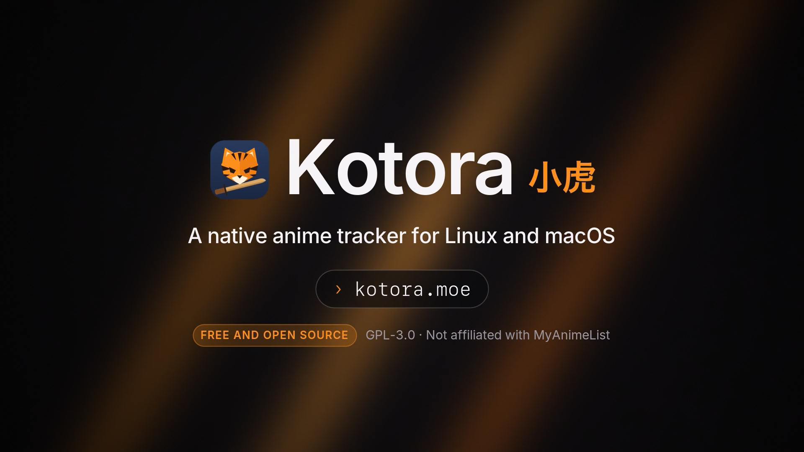
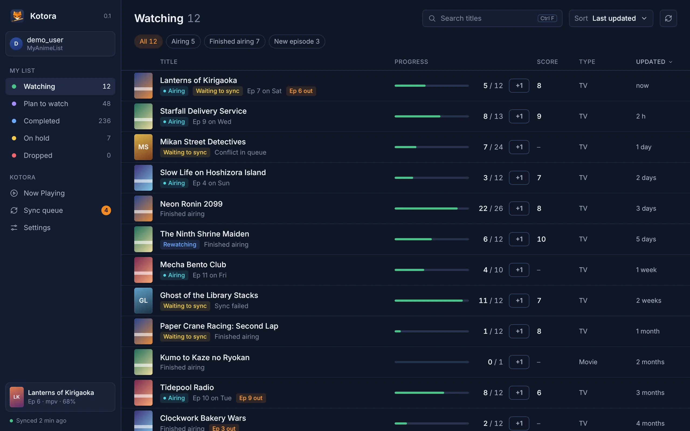
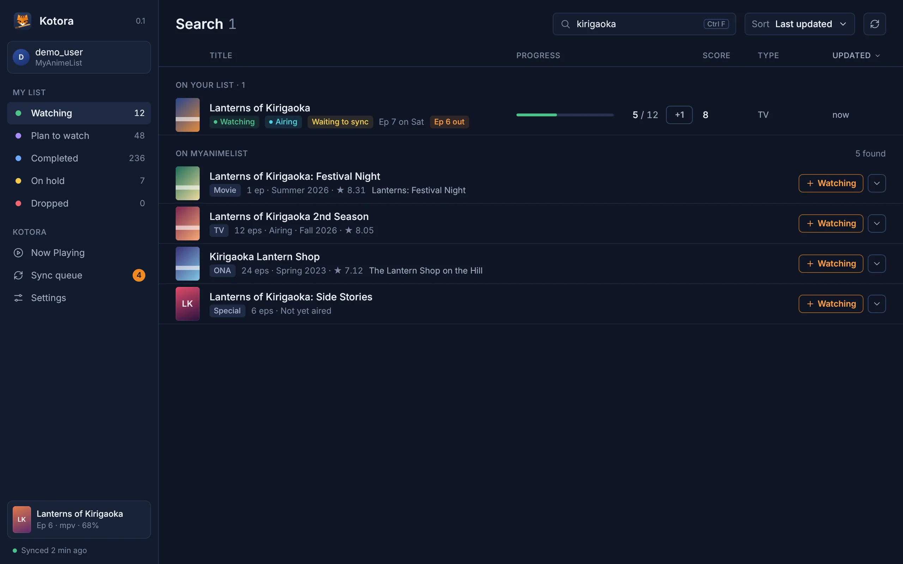

<p align="center"></p>

# Kotora 小虎

A native anime tracker for Linux and macOS, with a Windows preview, written in Rust.

Kotora ("little tiger") keeps your [MyAnimeList](https://myanimelist.net) or [AniList](https://anilist.co) list
up to date, anime and manga. It sees which episode is playing in your media player, and asks before it records
it. Your list stays on MyAnimeList or AniList; Kotora is only a client for your own account.

Website: <https://kotora.moe> · Support: <https://ko-fi.com/hanami117>



| Now Playing | Search and add | Details |
|---|---|---|
|  |  |  |

*The screenshots show made-up data.*

**Status:** version 0.3.0 is out (MyAnimeList or AniList, anime and manga).

## Features

- Your MyAnimeList or AniList list (from 0.2): Watching, Plan to watch, Completed, On hold, Dropped, with
  covers, progress, score and airing information. On AniList, airing times are AniList's exact schedule.
- Recognises the episode in your player and offers to record it ("Update to episode 6"). Updating
  automatically is a switch, and it is off by default.
- Edit progress, score and status. Changes go to a visible sync queue, so they work offline and conflicts
  are shown, not hidden.
- Search your list and MyAnimeList or AniList, add an anime in one click, open a details page.
- Manga (from 0.3, off until you turn it on): an Anime | Manga switch in the sidebar gives your MyAnimeList or
  AniList manga list its own pages (Reading, Plan to read, …), with chapters, volumes, score and rereads,
  search, add and remove, and Continue reading on Home. "Fill volumes from chapters" sets volumes read from
  chapters read with [MangaDex](https://mangadex.org/)'s volume tables, after a preview. In Manga mode,
  Publishing (in Airing's place) shows each Reading manga's latest chapter, how many you have left to read and
  an estimate of the next release, from [MangaUpdates](https://www.mangaupdates.com/) and MangaDex; New chapter
  notifications are opt-in.
- Signed in to both services, the mirror (Beta) sends every change you make to the other list too, anime and
  manga, and never overwrites an edit made on the other website (Settings → Account → Mirror edits to …).
- Import a MyAnimeList XML export (anime or manga) into either service, with a preview first; export a MyAnimeList anime or manga list as one (Settings → Account → Import anime list… / Import manga list…, Export anime list… / Export manga list…).
- Fast and small: no browser engine, a single binary, nothing running in the background that you didn't start.
- Discord Rich Presence, like Taiga (off by default): Settings → General → Show on Discord shows the episode you
  watch as your Discord status, with the cover, a button to the entry and the player's times. You can hide the
  title, or the status while paused. See [docs/DISCORD.md](docs/DISCORD.md).
- A command line, `kot`, to control the running app.

## Supported players

| Linux | macOS | Windows (preview) |
|---|---|---|
| mpv, VLC, mpc-qt, and other MPRIS players (Celluloid, Haruna, SMPlayer, …) | mpv, IINA, VLC | mpv, mpv.net, MPC-HC, MPC-BE, VLC, PotPlayer |

Kotora finds a player by the video file it has open, with no setup. For an exact position and pause, mpv
needs an IPC socket: Kotora offers to add one line to your `mpv.conf` (only when you click). On Windows the
same click works for mpv and mpv.net, and one turns on the web interface of MPC-HC and MPC-BE. Kotora does not
play, download or fetch video. For streaming sites, use [MAL-Sync](https://malsync.moe).

## Install

### Arch Linux

From the AUR, with your AUR helper:

```sh
yay -S kotora      # builds from the release's source
yay -S kotora-bin  # prebuilt x86_64 binary, no Rust toolchain needed
```

Both install `kotora`, `kot`, the menu entry and the icons, and they conflict with each other: pick one.
Updates come with your AUR helper. AUR pages: [kotora](https://aur.archlinux.org/packages/kotora) and
[kotora-bin](https://aur.archlinux.org/packages/kotora-bin).

The release page has a Linux x86_64 tarball (`kotora-0.3.0-linux-x86_64.tar.gz`). It is built on Arch
Linux, so it needs a recent glibc; on other distros, building from source is the safer way.

### macOS

Apple silicon, macOS 13 or later. Download `Kotora-0.3.0.dmg` from the
[release page](https://github.com/hanami117/kotora/releases/latest) and drag Kotora to Applications.

Kotora is not notarized, so macOS refuses it at the first start: open **System Settings → Privacy & Security**
and click **Open Anyway** (or run `xattr -dr com.apple.quarantine /Applications/Kotora.app`). To use `kot`,
link it into your `PATH`:

```sh
ln -s /Applications/Kotora.app/Contents/MacOS/kot /opt/homebrew/bin/kot
```

### Windows (preview)

Windows 10 or 11, 64-bit. Download
[Kotora-windows-x64-setup.exe](https://github.com/hanami117/kotora/releases/latest/download/Kotora-windows-x64-setup.exe)
and run it. It installs for your account only (no administrator rights), adds a Start menu entry and puts
`kot` on your PATH. A zip without an installer is on the release page.

Kotora is not signed yet, so Windows SmartScreen says "Windows protected your PC": click **More info**, then
**Run anyway**. The Windows build is new: please report problems.

### From source (Linux)

You need `rust`, `git` and `pkgconf`, and a Vulkan driver (`vulkan-radeon`, `vulkan-intel` or `nvidia-utils`).
On Debian or Ubuntu also `libdbus-1-dev`, `libxkbcommon-dev` and `libwayland-dev`.

```sh
git clone https://github.com/hanami117/kotora
cd kotora
./install.sh
```

This builds a release binary and installs `kotora` and `kot` into `~/.local/bin`, with the menu entry and
icons. Run `./install.sh` again after `git pull` to update. `./install.sh --uninstall` removes the program and
keeps your list, sign-in and settings. `PREFIX=/usr/local ./install.sh` installs elsewhere. The release's source
tarball (`kotora-0.3.0.tar.gz`) works the same way.

### From source (macOS)

With Rust and `librsvg` (`brew install librsvg`): `packaging/macos/build.sh` builds `target/macos/Kotora.app`.

## First start: sign in

Open Kotora and pick your service: **MyAnimeList** or **AniList** (AniList from 0.2). Press **Start**, then
**Sign in with MyAnimeList** (or **AniList**). Your browser opens the service's own page: allow (approve on
AniList) Kotora there and you are back in the app with your list. Kotora never sees your password. There is
nothing to register: Kotora has its own MyAnimeList and AniList client IDs built in. A client ID is public by
design (it identifies the app, it is not a secret), as it is in Taiga.

Kotora keeps one list at a time. Settings → Account → **Use AniList** (or **Use MyAnimeList**) switches; each
service keeps its own saved list, sign-in and waiting changes, so switching back loses nothing. If the browser
can't reach Kotora after AniList's page, paste the token or the address AniList showed into Kotora.

**Your own client ID (advanced).** If you would rather use an API client of your own, register one (MyAnimeList:
<https://myanimelist.net/apiconfig>, app type **other**; AniList: <https://anilist.co/settings/developer>) with
the redirect URL `http://127.0.0.1:47321/callback`, then Settings → Account → **Use my own client ID…** (or
`kot config client-id ID`, for the service in use). **Use Kotora's built-in ID** there goes back. Developers can
also set `KOTORA_MAL_CLIENT_ID` or `KOTORA_ANILIST_CLIENT_ID`, which win over both.

## Privacy

- **No telemetry, no analytics, no account of ours.** Apart from your list service, the update check below is
  the only thing Kotora sends anywhere on its own.
- Your list lives on MyAnimeList or AniList. Kotora keeps a local copy to work offline, and covers in a cache you
  can delete. Kotora talks to AniList only for your own account, within AniList's rate limit, and never exports
  or collects AniList's data.
- **Update check:** once a day, a plain GET of `https://updates.kotora.moe/latest.json` with the User-Agent
  `Kotora/<version>` and four values: the Kotora version, the OS (Linux, macOS or Windows), the processor type
  (x86_64 or arm64) and how it was installed (AUR, install.sh, Homebrew, DMG, …), plus a flag on the first
  check of a week and of a month. No id, no account, no list, file or anime names. The server adds one to a
  counter for that day and that combination; those daily counts are all it keeps: no IP address, no install
  or device id, no cookies. If that server can't be reached, Kotora asks `https://kotora.moe/latest.json`
  instead, which counts nothing. Kotora never downloads an update by itself: it shows a banner, and you
  choose. Turn it off in Settings → About Kotora → **Check for updates**; then nothing is sent.
- **Discord (off by default):** with Settings → General → **Show on Discord** on, Kotora talks to the Discord app
  on your own computer over its local socket and gives it your status (title, episode, cover link). Kotora makes
  no connection to Discord itself; Discord's servers fetch the cover from your list service. Off, nothing runs.
- The sign-in tokens (one per service) are stored in a file only you can read (`~/.local/share/kotora/tokens.json`), never in
  the database or logs. Kotora needs no client secret.
- Files: settings in `~/.config/kotora`, list and token in `~/.local/share/kotora`, covers in `~/.cache/kotora`,
  the update check's last answer and skipped version in `~/.local/state/kotora/update.json`.

## The `kot` command

`kot` talks to the running app.

```text
kot                    a dashboard: what plays, your Watching list with what comes next, the sync queue
kot status [--short]   what Kotora is doing (--short: one line)
kot list [STATUS|all]  your list (watching, plan, completed, on-hold, dropped)
kot +1 TITLE           one more episode
kot set TITLE EP [--status S] [--score N|none]
kot add QUERY|ID [--status S]
kot remove TITLE|ID [--yes]
kot manga [on|off]     whether syncs also read your manga list
kot list --manga [STATUS|all]   your manga list (reading, plan, completed, on-hold, dropped)
kot set --manga TITLE|ID [CH] [--volumes N] [--status S] [--score N|none]
kot add --manga QUERY|ID | kot remove --manga TITLE|ID
kot fill-volumes [--yes]   volumes read from chapters read (MangaDex), after a preview
kot airing | schedule   your anime airing in the next 7 days
kot publishing | chapters   your Reading manga's latest chapters (MangaUpdates)
kot now                what plays, and the episode Kotora offers
kot confirm            record the offered episode
kot dismiss            not now
kot queue              changes waiting to sync
kot sync               send the queue now
kot export [--manga] FILE   your anime list (--manga: your manga list) as a MyAnimeList XML file (MyAnimeList lists only)
kot config client-id ID   (optional: your own client ID for the service in use)
kot show | kot quit
```

## Credits and notices

Kotora is a tribute to [Taiga](https://taiga.moe/) by erengy, the anime tracker for Windows. Kotora shares no
code with Taiga.

Kotora is not affiliated with or endorsed by MyAnimeList, AniList, MangaDex or MangaUpdates. Third-party licences are in
[THIRD_PARTY_NOTICES.md](THIRD_PARTY_NOTICES.md).

## License

Copyright © 2026 Thomas Lonigro.

GPL-3.0-or-later. See [LICENSE](LICENSE).

## Credits

- [Taiga](https://taiga.moe/) by erengy, which Kotora follows.
- [anime-relations](https://github.com/erengy/anime-relations) (public domain, CC0): the episode
  redirection rules, built in and refreshed from GitHub at most once a week.
- [anitomy](https://github.com/erengy/anitomy) (MPL-2.0), through
  [anitomy-ng](https://github.com/tylergibbs2/anitomy-ng): file name parsing.
- [Noto Sans JP](https://github.com/notofonts/noto-cjk) (SIL Open Font License 1.1): the outlines of 小虎
  in the sidebar and the startup animation.
- [MangaDex](https://mangadex.org/): volume data for "Fill volumes from chapters" (its public API, asked only
  when you use it, within its rate limit).
- [MangaUpdates](https://www.mangaupdates.com/): release data for Publishing and New chapter notifications
  (its public API, only with Manga on, for Reading manga, cached, at most every 4 hours per series).
- [MangaDex](https://mangadex.org/): release data for Publishing too, official chapters it links to included
  (its public API; a series is used only when it links to your list's MyAnimeList or AniList id). Each source
  can be turned off in Settings → Manga.
